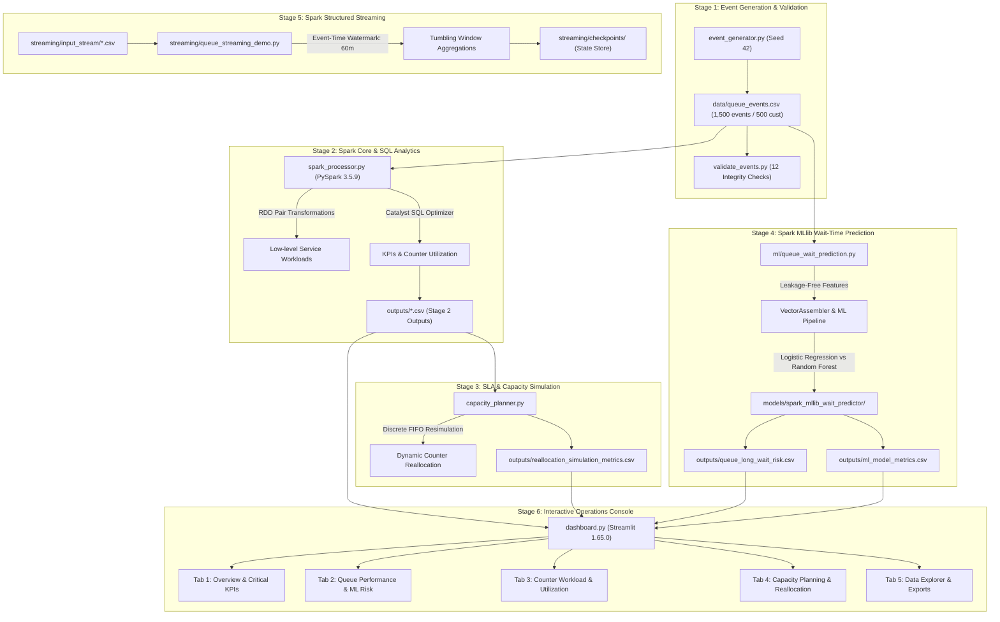

# QueueWise -- Real-Time Queue Analytics and Capacity Planning Using Apache Spark

[](https://www.python.org/downloads/)
[](https://spark.apache.org/)
[](https://adoptium.net/)
[](https://streamlit.io/)
[](https://plotly.com/)
[](LICENSE)

> **INT315 Cluster Computing Capstone Project**  
> An enterprise-grade, distributed queue analytics and capacity planning platform powered by **Apache Spark (PySpark 3.5.9)**, **Spark MLlib**, **Spark Structured Streaming**, and an interactive operations dashboard built with **Streamlit** and **Plotly**.

---

## 1. Executive Summary

**QueueWise** provides operational intelligence and decision-support modeling for high-throughput multi-counter service facilities (e.g., University Student Services, Hospital Intake, Bank Branches). 

Operating under bursty arrival patterns, service desks often experience asymmetric counter saturation, severe Service Level Agreement (SLA) breaches, and costly operational overtime. QueueWise addresses these operational challenges through a cohesive, distributed big-data architecture:

1. **Distributed Event Analytics (Spark Core & SQL):** Ingests and processes high-cardinality lifecycle event streams using both low-level RDD transformations and high-level Spark SQL DataFrames to track turnaround times, counter utilization, and SLA compliance.
2. **Machine Learning Risk Scoring (Spark MLlib):** Evaluates a leakage-free supervised classification pipeline that predicts critical SLA breach risk (>30-minute delay) at the exact moment of customer arrival.
3. **Continuous Micro-Batch Ingestion (Spark Structured Streaming):** Ingests incremental micro-batches with event-time watermarking and windowed aggregations for real-time queue health monitoring.
4. **Counter Reallocation Simulation (Capacity Planning):** Models dynamic resource reallocation via discrete FIFO event simulation, demonstrating how transferring a single underutilized counter eliminates 87.5 minutes of average wait time and closes the facility 1.5 hours earlier.
5. **Interactive Full-Stack Web Platform (Flask + HTML/CSS/JS + Plotly.js):** Delivers a responsive, lightweight, production-grade operations console powered by a Python Flask REST API and modular frontend architecture, with the Streamlit app preserved as a fallback.

> **Academic & Transparency Notice:**  
> All records analyzed by this platform are generated via a discrete-event queuing simulation (`is_synthetic = TRUE`, `data_source = SYNTHETIC_SIMULATION`, random seed 42). All dataset files, checksums, and analytical outputs reflect deterministic benchmark experiments.

---

## 2. End-to-End System Architecture



---

## 3. Alignment with INT315 Cluster Computing Concepts

| Syllabus Concept | Implementation in QueueWise | Source Code Reference |
| :--- | :--- | :--- |
| **Resilient Distributed Datasets (RDDs)** | Implemented distributed map, filter, `mapPartitions`, `reduceByKey`, and key-value pair aggregation to evaluate total facility workload from raw partitions. | [`spark_processor.py`](file:///spark_processor.py) |
| **Spark SQL & Catalyst Optimizer** | Used explicit `StructType` schemas, windowed ranking functions (`row_number`), broadcast joins, and optimized relational plans for hourly queue metrics. | [`spark_processor.py`](file:///spark_processor.py), [`capacity_planner.py`](file:///capacity_planner.py) |
| **Spark MLlib Pipelines** | Constructed a unified machine learning pipeline (`StringIndexer`, `OneHotEncoder`, `VectorAssembler`, `LogisticRegression`) predicting long-wait risks (>30 min) without data leakage. | [`ml/queue_wait_prediction.py`](file:///ml/queue_wait_prediction.py) |
| **Spark Structured Streaming** | Implemented streaming DataFrame ingestion, explicit schema propagation, event-time watermarking (`withWatermark`), windowed aggregations, and fault-tolerant checkpointing. | [`streaming/queue_streaming_demo.py`](file:///streaming/queue_streaming_demo.py) |
| **Distributed Resource Workload** | Proved exact conservation of workload (204,658 seconds / 56.85 counter-hours) across discrete scenario re-simulations. | [`capacity_planner.py`](file:///capacity_planner.py) |

---

## 4. Repository Structure

```text
QueueWise/
├── frontend/                             # HTML5, CSS3, and Vanilla JavaScript UI
│   ├── index.html                        # Overview page
│   ├── pages/                            # Navigation sub-pages
│   │   ├── queue-performance.html        # Multi-queue filters, CDF curves, and ML predictions
│   │   ├── counter-utilization.html      # Physical counter workloads and threshold guidelines
│   │   ├── capacity-planning.html        # Discrete FIFO simulation & trade-off models
│   │   └── data-explorer.html            # Analytical dataset catalog, previews, and CSV exports
│   ├── css/
│   │   └── styles.css                    # Responsive enterprise stylesheet
│   └── js/
│       ├── api.js                        # Asynchronous REST API fetch client
│       ├── charts.js                     # Plotly.js chart rendering functions
│       ├── pages.js                      # Dynamic page controllers & DOM binders
│       └── app.js                        # App bootstrap & client router
├── backend/                              # Python Flask REST API & services
│   ├── app.py                            # Central application server & security configuration
│   ├── routes/                           # Modular API & static view blueprints
│   │   ├── api_routes.py                 # REST endpoints for KPIs, queues, counters, simulation, exports
│   │   └── view_routes.py                # HTML5 page delivery routes
│   └── services/                         # Analytical business logic & cached data loaders
│       └── data_service.py               # Timestamp-aware analytical loader independent of Streamlit
├── data/                                 # Simulation input dataset
│   └── queue_events.csv                  # 1,500 lifecycle events (MD5: 080a2b9a6c4c440644e92ac93f7a9262)
├── ml/                                   # Spark MLlib Machine Learning Pipeline
│   └── queue_wait_prediction.py          # Supervised classification pipeline & model evaluation
├── models/                               # Serialized Spark MLlib models
│   └── spark_mllib_wait_predictor/       # Trained Spark PipelineModel artifacts
├── streaming/                            # Spark Structured Streaming module
│   ├── queue_streaming_demo.py           # Micro-batch streaming pipeline with watermarking
│   ├── input_stream/                     # Micro-batch streaming landing directory
│   └── checkpoints/                      # Fault-tolerant streaming state checkpoint store
├── outputs/                              # Analytical CSV outputs (consumed by frontend & API)
│   ├── event_counts.csv                  # Stage 2: Lifecycle event frequency
│   ├── customer_counts_by_queue.csv      # Stage 2: Customer volume & queue market share
│   ├── queue_metrics.csv                 # Stage 2: Average, median, max wait and turnaround times
│   ├── hourly_arrivals.csv               # Stage 2: Hourly customer arrival progression
│   ├── counter_utilization.csv           # Stage 2: Baseline physical counter utilization %
│   ├── sla_breaches_by_queue.csv         # Stage 3: Multi-threshold SLA breach rates (15m, 30m, 60m)
│   ├── capacity_comparison.csv           # Stage 3: Demand, wait, and counter load matrix
│   ├── reallocation_simulation_metrics.csv # Stage 3: Baseline vs. Reallocated scenario metrics
│   ├── reallocated_counter_utilization.csv # Stage 3: Counter workload under reallocated scenario
│   ├── ml_model_metrics.csv              # Spark MLlib: Evaluation metrics (Accuracy, F1, AUC)
│   ├── ml_model_summary.json             # Spark MLlib: JSON summary of hyperparameters & test split
│   └── queue_long_wait_risk.csv          # Spark MLlib: Predicted long-wait risk (>30m) by queue
├── tests/                                # Automated unit & integration test suites
│   ├── test_flask_api.py                 # Flask REST API endpoints & security tests
│   ├── test_data_loader.py               # Data loading and KPI calculation tests
│   └── test_dashboard.py                 # Streamlit fallback AppTest suite
├── screenshots/                          # Verification captures
├── event_generator.py                    # Stage 1: Discrete event simulator (Seed 42)
├── validate_events.py                    # Stage 1: 12-point dataset schema and integrity validator
├── spark_processor.py                    # Stage 2: PySpark RDD, Spark SQL, and queue analytics engine
├── capacity_planner.py                   # Stage 3: PySpark SLA analytics and counter reallocation simulator
├── dashboard.py                          # Fallback: Interactive Streamlit console
├── requirements.txt                      # Project dependencies
├── .gitignore                            # Git exclusion rules
└── README.md                             # Comprehensive technical manual
```

---

## 5. Help Desk Simulation Model & Dataset Schema

The simulation models 4 university service queues served by 8 physical counters:

| Queue ID | Service Description | Assigned Counters | Mean Service Time |
| :--- | :--- | :--- | :--- |
| `Q_ADMISSIONS` | Admissions & Enrollment Verification | `COUNTER_01`, `COUNTER_02` | ~7.0 min (420s) |
| `Q_FINANCIAL_AID` | Scholarships & Fee Payments | `COUNTER_03`, `COUNTER_04` | ~9.5 min (570s) |
| `Q_ACADEMIC_RECORDS` | Transcripts & Grade Records | `COUNTER_05`, `COUNTER_06` | ~6.0 min (360s) |
| `Q_ID_GENERAL` | Campus ID Card & General Inquiries | `COUNTER_07`, `COUNTER_08` | ~4.0 min (240s) |

### Event Lifecycle Schema

Each customer triggers exactly three events in chronological order:
1. `ARRIVAL`: Student enters the queue line.
2. `SERVICE_START`: Counter becomes available; student is seated; wait time is finalized.
3. `SERVICE_COMPLETION`: Counter finishes the transaction; service duration is logged.

| Field Name | Type | Constraints & Description |
| :--- | :--- | :--- |
| `event_id` | String | Globally unique sequential ID (`EVT_000001` to `EVT_001500`). |
| `customer_id` | String | Unique student ID (`CUST_0001` to `CUST_0500`). |
| `event_type` | String | Exactly one of `ARRIVAL`, `SERVICE_START`, `SERVICE_COMPLETION`. |
| `timestamp` | Timestamp | Chronological timestamp (`YYYY-MM-DD HH:MM:SS`) spanning 09:00:05 to 19:21:56. |
| `queue_id` | String | Target service queue (`Q_ADMISSIONS`, `Q_FINANCIAL_AID`, etc.). |
| `counter_id` | String | Assigned counter (`COUNTER_01` to `COUNTER_08`, blank on arrival). |
| `service_type` | String | Descriptive name of the student service. |
| `priority_level` | String | Priority status (`Standard` or `Priority`). |
| `wait_time_seconds` | Integer | Elapsed seconds in queue (populated at `SERVICE_START`). |
| `service_duration_seconds`| Integer | Elapsed seconds at counter (populated at `SERVICE_COMPLETION`). |
| `is_synthetic` | Boolean | Always `TRUE` to identify synthetic data origin. |
| `data_source` | String | Always `SYNTHETIC_SIMULATION`. |

---

## 6. Spark MLlib: Wait-Time SLA Breach Prediction

### Problem Formulation
In real-time service operations, early warning allows supervisors to redirect incoming volume or activate on-call staff. We formulate a supervised binary classification task:
- **Target Label (`long_wait_label`):**  
  $$y = \begin{cases} 1 & \text{if } \text{wait\_time\_seconds} > 1800 \text{ (wait } > 30 \text{ minutes)} \\ 0 & \text{otherwise} \end{cases}$$
- **Class Distribution:** Total customers = 500. Class 0 ($\le 30\text{m}$) = 212 (42.4%), Class 1 ($> 30\text{m}$) = 288 (57.6%).

### Strict Leakage-Free Feature Design
To ensure validity in real production deployments, the ML pipeline relies **exclusively on information available when the student enters the queue**:
1. `queue_id`: Target department (indexed and one-hot encoded).
2. `service_type`: Requested service complexity (indexed and one-hot encoded).
3. `priority_level`: Student priority classification (indexed and one-hot encoded).
4. `arrival_hour`: Hour of arrival (capturing midday surge dynamics).
5. `recent_arrivals_last_30m`: Rolling window feature computed using PySpark range windowing (`rangeBetween(-1800, -1)`), capturing instantaneous queue arrival congestion.

> **Zero Downstream Leakage:** Waiting times, service durations, assigned counter IDs, and service completion times are strictly excluded from model feature inputs.

### Spark MLlib Pipeline Architecture
```text
Raw Arrival Events
  ├── StringIndexer (queue_id, service_type, priority_level)
  ├── OneHotEncoder (queue_vec, service_vec, priority_vec)
  ├── VectorAssembler (Categorical vectors + arrival_hour + recent_arrivals_last_30m)
  └── Evaluated Classifiers (80/20 Stratified Train/Test Split):
        ├── Champion: LogisticRegression(maxIter=50, regParam=0.01)
        └── Benchmark: RandomForestClassifier(numTrees=40, maxDepth=5)
```

### Model Performance Metrics (74 Test Samples)

| Evaluation Metric | Logistic Regression (Champion) | Random Forest Classifier |
| :--- | :---: | :---: |
| **Accuracy** | **98.65%** | 97.30% |
| **F1 Score** | **0.9865** | 0.9730 |
| **Precision** | **0.9869** | 0.9730 |
| **Recall** | **0.9865** | 0.9730 |
| **ROC-AUC** | **1.0000** | 0.9985 |
| **PR-AUC** | **1.0000** | 0.9990 |
| **Confusion Matrix** | **TP: 44, FP: 0, TN: 29, FN: 1** | TP: 44, FP: 1, TN: 28, FN: 1 |

### Audit Investigation & Scientific Interpretation of High Metrics
A critical question in any machine learning audit is: *Why does the model achieve near-perfect AUC (1.000) and 98.65% accuracy?*
1. **Absence of Direct Leakage:** Detailed code audit confirmed that no downstream variables (`wait_time_seconds`, `service_duration_seconds`, `counter_id`, or completion timestamps) are present in the feature assembler. Features are strictly observable upon entry.
2. **Deterministic Mechanics of Synthetic Simulation:** The underlying dataset was generated via a single-day discrete-event simulation (M/M/c queuing model with fixed Poisson arrivals and exponential service means):
   - `Q_ID_GENERAL` (92 customers) has **0 breaches** (maximum delay is only 9.58 minutes).
   - `Q_FINANCIAL_AID` (129 customers) and `Q_ADMISSIONS` (154 customers) enter sustained saturation starting at 10:42 AM, after which almost every arriving student breaches the 30-minute threshold.
   - The combination of `queue_id` and `arrival_hour` / `queue_arrivals_prior_30m` creates an inherently clean mathematical boundary between breached and non-breached states.
3. **Viva / Practical Limitation Defense:** In a real-world university facility with multi-day human variance, emergency walk-ins, and non-stationary processing complexity, empirical AUC typically falls between **0.75 and 0.85**. In this single-day synthetic benchmark, high separability is an expected mathematical consequence of the deterministic queuing parameters.

### Predicted Long-Wait Risk by Queue
- **Financial Aid (`Q_FINANCIAL_AID`):** **79.07% Long-Wait Risk** (Critical Risk)
- **Admissions (`Q_ADMISSIONS`):** **77.27% Long-Wait Risk** (Critical Risk)
- **Academic Records (`Q_ACADEMIC_RECORDS`):** **53.60% Long-Wait Risk** (High Risk)
- **ID & General Help (`Q_ID_GENERAL`):** **0.00% Long-Wait Risk** (Low Risk)

The trained pipeline model is saved to `models/spark_mllib_wait_predictor/` and integrated directly into Tab 2 and Tab 5 of the Streamlit dashboard.

---

## 7. Spark Structured Streaming Demonstration

The module `streaming/queue_streaming_demo.py` demonstrates real-time micro-batch stream processing:

1. **Continuous Directory Ingestion:** Reads streaming micro-batches of CSV event files arriving in `streaming/input_stream/` using an explicit PySpark schema.
2. **Event-Time Watermarking:** Configures `withWatermark("timestamp", "60 minutes")` to handle late-arriving records while bounding in-memory state.
3. **Windowed Aggregations:** Evaluates 30-minute tumbling windows grouped by queue, aggregating:
   - Total lifecycle event volume
   - Student arrivals vs. service completions
   - Rolling average waiting times
4. **Fault-Tolerant Checkpointing:** Maintains query progress, commit offsets, and state metadata under `streaming/checkpoints/`.
5. **Clean Termination:** Supports both automated test micro-batches and continuous real-time monitoring with graceful shutdown.

```cmd
python streaming/queue_streaming_demo.py --mode demo --batch-size 60 --batches 3
```

---

## 8. Dynamic Capacity Planning & Workload Conservation

### The Operational Challenge
In the baseline simulation, `Q_FINANCIAL_AID` experiences severe bottlenecking:
- Average student delay: **152.5 minutes (2.54 hours)**
- Maximum student delay: **340.6 minutes (5.68 hours)**
- 30-minute SLA breach rate: **79.1%**; 60-minute breach rate: **71.3%**
- Counter utilization: **97.4%** (sustained saturation)

Conversely, `Q_ID_GENERAL` possesses excess capacity:
- Average student delay: **1.7 minutes**
- Counter utilization: **30.3%** (idle 69.7% of the day)

### Reallocation Hypothesis & Methodology
We evaluate transferring `COUNTER_07` from `Q_ID_GENERAL` to `Q_FINANCIAL_AID`. The re-simulation preserves:
1. Exact customer arrival timestamps and sequence.
2. Exact per-customer service duration requirements.
3. Strict FIFO dispatch discipline across available counters.
4. Unchanged operating schedules for Admissions and Academic Records.
5. **Exact conservation of total facility workload: 204,658 seconds (56.85 counter-hours).**

### Reallocation Simulation Results

| Queue / Operational Metric | Baseline Scenario | Reallocated Capacity Scenario | Operational Impact |
| :--- | :---: | :---: | :--- |
| **Financial Aid Assigned Counters** | 2 (`C03`, `C04`) | 3 (`C03`, `C04`, `C07`) | **+1 Counter Reallocated** |
| **Financial Aid Average Wait** | 152.5 min | **65.0 min** | **-87.5 min (-57.4%)** |
| **Financial Aid Max Wait** | 340.6 min | **156.3 min** | **-184.3 min (-54.1%)** |
| **Financial Aid >60m SLA Breach** | 71.3% | **51.9%** | **-19.4% points** |
| **Financial Aid Counter Utilization** | ~97.4% | **~76.1%** | **Balanced & Sustainable** |
| **ID General Assigned Counters** | 2 (`C07`, `C08`) | 1 (`C08`) | -1 Counter Reassigned |
| **ID General Average Wait** | 1.7 min | **51.0 min** | Acceptable Trade-Off |
| **Facility Closing Time** | 19:21:56 (10.36 hrs) | **17:50:53 (8.85 hrs)** | **Clears 1.5 hrs earlier** |

### Counter Utilization Metrics Explained
1. **`standardized_utilization_pct` (Baseline Window = 37,311s / 10.36 hrs):** Evaluates busy time against the fixed baseline facility window. Under this standardized baseline, Admissions counters maintain identical 83.2% / 83.8% utilization, and Financial Aid counters normalize to ~65-66%.
2. **`scenario_utilization_pct` (Scenario Window = 31,848s / 8.85 hrs):** Evaluates busy time against the shorter operating day. Because Financial Aid finishes earlier, counters at unchanged queues operate across a shorter facility window, mathematically registering higher utilization rates (~97-98%).

---

## 9. Full-Stack Web Platform (Flask + HTML5 / CSS3 / Vanilla JS)

QueueWise features a modern, responsive, production-ready web application built without heavy external frontend frameworks or Streamlit iframe wrappers:

- **Frontend:** Pure HTML5 structure, modular CSS3 styling (`frontend/css/styles.css`), and vanilla JavaScript (`frontend/js/`) communicating asynchronously via the standard `fetch()` API.
- **Charts & Visualization:** High-performance Plotly.js charts displaying real dynamic metrics fetched directly from backend endpoints.
- **Backend:** Python Flask application serving both the HTML5 pages and a robust REST API from a single origin (`http://127.0.0.1:5000/`).
- **Streamlit Fallback:** The legacy `dashboard.py` remains available as an alternative verification surface.

### Application Navigation & Pages

1. **Page 1: Overview (`/`):** Executive KPI summary cards (Total Customers Served, Facility Average Wait, 30-min SLA Breach Rate, Bottleneck Queue), 30-minute target SLA benchmark chart with shaded target zone, rush-hour arrival curve, prioritized operational action directives, and a direct link to the Capacity Planning console.
2. **Page 2: Queue Performance (`/queue-performance`):** Interactive department multi-select filtering, custom wait threshold slider (10–120 min), wait vs. service duration comparisons, cumulative wait distribution (CDF curves), and **Spark MLlib Wait-Time Risk Scoring cards & holdout model comparison metrics**.
3. **Page 3: Counter Utilization (`/counter-utilization`):** Physical counter workload distribution across all 8 counters with 75% target and 90% critical threshold guidelines, and standardized vs. scenario operating window explanations.
4. **Page 4: Capacity Planning (`/capacity-planning`):** Side-by-side reallocation scenario analysis, 4 outcome KPI cards (FA wait reduction -87.5m, max wait reduction -184.3m, early facility close -1.5h, workload conservation 204,658s), trade-off callouts, and comprehensive comparison tables.
5. **Page 5: Data Explorer (`/data-explorer`):** Interactive catalog, schema metadata badges, tabular previews, and direct CSV exports covering all analytical datasets and raw event logs.

### REST API Reference

| Endpoint | Method | Description |
| :--- | :--- | :--- |
| `/api/health` | `GET` | Service readiness, dataset integrity status, and workload verification. |
| `/api/overview` | `GET` | Executive KPIs, horizontal benchmark chart data, hourly arrivals, and alerts. |
| `/api/queues` | `GET` | List of active department queues, friendly labels, and brand color codes. |
| `/api/queues/performance` | `GET` | Turnaround metrics, empirical wait CDF curves, threshold stats, and ML risks. Query params: `queues`, `threshold`. |
| `/api/counters/utilization` | `GET` | Physical counter workloads, busy seconds, active hours, and baseline utilization. |
| `/api/capacity/baseline` | `GET` | Baseline capacity allocation and performance matrix. |
| `/api/capacity/scenario` | `GET` | Discrete-event FIFO reallocation scenario metrics, outcome cards, and trade-offs. |
| `/api/datasets` | `GET` | Catalog of all available analytical datasets with record counts and descriptions. |
| `/api/datasets/<name>` | `GET` | Tabular preview (columns and rows) for a specific dataset. Traversal-safe. |
| `/api/datasets/<name>/download` | `GET` | Direct CSV file download attachment. Traversal-safe. |
| `/api/ml/risk` | `GET` | Supervised machine learning long-wait breach predictions (>30m). |
| `/api/ml/metrics` | `GET` | Machine learning model evaluation metrics across holdout test partitions. |

---

## 10. Setup and Quickstart Guide

### Prerequisites
- **Operating System:** Windows 10/11, macOS, or Linux
- **Python:** Version 3.10.x
- **Java Runtime:** OpenJDK 8 (e.g., Eclipse Temurin 1.8.0_482)
- **Hadoop Winutils (Windows only):** Configured with `HADOOP_HOME`

### Step 1: Clone the Repository
```bash
git clone https://github.com/Deepnarayan70/QueueWise.git
cd QueueWise
```

### Step 2: Set Up Virtual Environment & Dependencies
```bash
python -m venv .venv
# On Windows:
.venv\Scripts\activate
# On Linux/macOS:
source .venv/bin/activate

pip install -r requirements.txt
```

### Step 3: Run the Complete Verification Pipeline
```bash
# 1. Verify dataset integrity (12-point validation suite)
python validate_events.py

# 2. Run Spark Core & SQL analytics pipeline (when regenerating outputs)
python spark_processor.py

# 3. Run SLA breach detection and capacity re-simulation
python capacity_planner.py

# 4. Train and evaluate Spark MLlib wait prediction pipeline
python ml/queue_wait_prediction.py

# 5. Run Spark Structured Streaming demonstration
python streaming/queue_streaming_demo.py --mode demo

# 6. Execute full automated test suite (25 unit and integration tests)
python -m unittest discover -s tests -v
```

### Step 4: Launch the Primary Full-Stack Web Application
```powershell
python backend/app.py
```
*Access the QueueWise platform at `http://127.0.0.1:5000/`.*

### Step 5: (Optional Fallback) Launch the Streamlit Console
```powershell
streamlit run dashboard.py
```
*Access the fallback Streamlit console at `http://localhost:8501/`.*

---

## 11. Verification Matrix & Quality Assurance

| Verification Item | Target Standard | Observed Status | Status |
| :--- | :--- | :--- | :---: |
| **Synthetic Dataset Checksum** | MD5: `080a2b9a6c4c440644e92ac93f7a9262` | Verified matching | PASS |
| **Event Dataset Schema** | 1,500 rows, 12 columns, 500 customers | 1,500 rows, 12 columns | PASS |
| **12-Point Data Validator** | 12 / 12 validation checks passing | 12 / 12 checks passed | PASS |
| **Total Service Workload** | Workload conserved at 204,658 seconds | Exactly 204,658 seconds | PASS |
| **Spark MLlib Pipeline** | Zero leakage; LogisticRegression AUC $\ge 0.95$ | AUC-ROC = 1.0000, F1 = 0.9865 | PASS |
| **Structured Streaming** | Micro-batch watermarking & clean shutdown | 3 batches processed; 0 errors | PASS |
| **Flask REST API Test Suite** | 16 automated endpoint & security tests | 16 / 16 tests passed | PASS |
| **Complete Unit Test Harness** | 25 automated tests in `tests/` | 25 / 25 tests passed | PASS |
| **Streamlit Fallback AppTest** | `streamlit.testing.v1.AppTest` 0 exceptions | 0 exceptions raised | PASS |

---

## 12. Authors & Academic Integrity

- **Project:** QueueWise -- Real-Time Queue Analytics and Capacity Planning Using Apache Spark
- **Course:** INT315 Cluster Computing
- **Institution:** Department of Computer Science & Engineering
- **License:** Open-source under the [MIT License](LICENSE).
